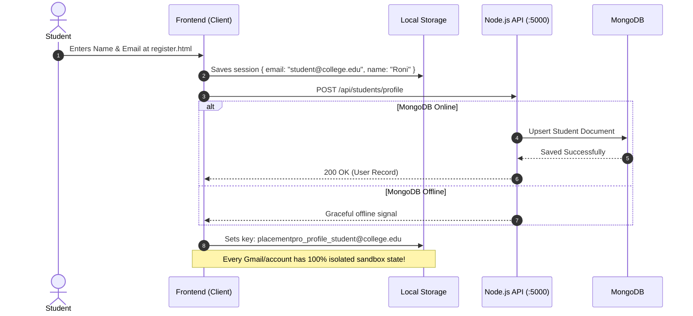
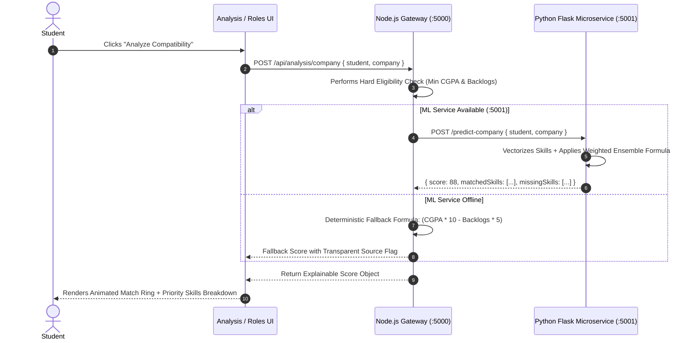
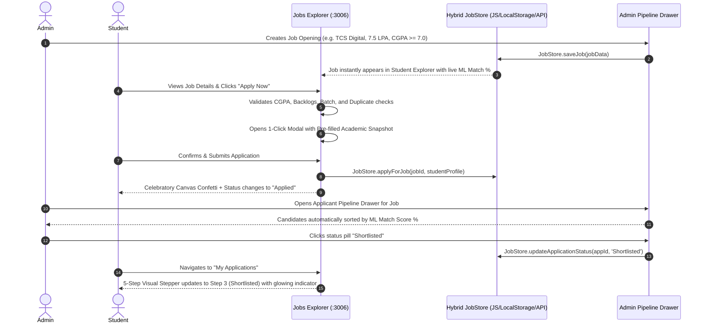

# 01. PlacementPro AI — Comprehensive System Overview

## 1. Executive Summary & Vision
**PlacementPro AI (formerly EduScope)** is an enterprise-grade, ML-driven Student Placement Guidance, Company Eligibility Predictor, Career Recommendation, and Job Application Platform. 

Developed specifically for undergraduate engineering students and campus placement cells (T&P), the platform eliminates guesswork in campus hiring. It evaluates student academic parameters (CGPA, active backlogs, graduation year, degree/branch) and technical vectors against real-world corporate recruitment benchmarks to deliver:
1. **Dynamic ML Career Role & Company Suitability Predictions**
2. **Actionable Skill-Gap Diagnostics with High/Medium/Low Priority Roadmaps**
3. **An Enterprise Job Portal & Application Management Suite** (with live ML match rings, 1-click application verification, candidate slide-over pipeline drawer, and 5-step interactive progress tracking)
4. **A Split-Screen Live AI Resume Studio** (with real-time STAR-method bullet rewriting, action verb upgrading with glowing visual feedback, dynamic ATS keyword injection, and recruiter-approved visual templates)
5. **Zero-Crash Resilient Hybrid Storage Architecture** (guaranteeing 100% functionality whether MongoDB is online or offline via per-user email-isolated localStorage synchronization)

---

## 2. Decoupled 3-Tier Microservices Architecture

```
                                    ┌─────────────────────────────────────────────────────────────┐
                                    │                     CLIENT TIER (PORT 3006)                 │
                                    │  HTML5 + CSS3 (Claymorphic) + Bootstrap 5 + Vanilla ES6+ JS │
                                    └──────────────┬──────────────────────────────┬───────────────┘
                                                   │                              │
                            Local Sync Layer       │ HTTP / REST                  │ Direct Browser
                        (JobStore / ProfileStore)  │ CORS Requests                │ Fallback Mode
                                                   ▼                              ▼
                                    ┌──────────────────────────────┐       ┌──────────────────────┐
                                    │    APPLICATION GATEWAY       │       │ ISOLATED LOCALSTORE  │
                                    │      (NODE.JS / EXPRESS)     │       │ placementpro_profile_│
                                    │           PORT 5000          │◄─────►│ placementpro_jobs_   │
                                    └──────────────┬───────────────┘       │ placementpro_apps_   │
                                                   │                       └──────────────────────┘
                         Internal Microservice     │ Mongoose ODM
                         Forwarding (Axios)        │ Connection
                                                   ▼
                    ┌──────────────────────────────┐    ┌──────────────────────────────┐
                    │    DATA SCIENCE TIER         │    │       PERSISTENCE LAYER      │
                    │   (PYTHON 3 / FLASK)         │    │           (MONGODB)          │
                    │        PORT 5001             │    │           PORT 27017         │
                    │  Scikit-Learn Random Forest  │    │ Collections: students, jobs, │
                    │  Feature Matrix Calculators  │    │ applications, companies      │
                    └──────────────────────────────┘    └──────────────────────────────┘
```

### The Three Independent Tiers
1. **Presentation Tier (Port 3006 / Static Client)**:
   - Built with modern Semantic HTML5, Vanilla CSS3 utilizing claymorphic surface tokens (`--pp-clay`, `--pp-surface`), Bootstrap 5 grid utilities, and native ES6+ JavaScript.
   - High performance, instant page switches, zero client-framework hydration latency, and absolute visual wow-factor.
2. **Application Tier (Port 5000 / Node.js & Express.js)**:
   - The central API orchestrator, security gatekeeper, and business logic engine.
   - Handles route routing, Mongoose schema validation, deterministic fallback scoring, job publishing lifecycles, and cross-tier communication to the Python ML microservice.
3. **Data Science Tier (Port 5001 / Python 3 & Flask)**:
   - A dedicated predictive analytics microservice running Scikit-Learn estimators.
   - Exposes REST endpoints (`/predict-role`, `/predict-company`, `/skill-gap`) for statistical inference, multi-class role probability ranking, and algorithmic gap weighting.

---

## 3. End-to-End Data Flow & Lifecycle Diagrams

### Data Flow A: Student Registration, Profile Building & Email Isolation


---

### Data Flow B: ML Company Eligibility & Role Prediction Pipeline


---

### Data Flow C: Job Portal Application Lifecycle & Admin Pipeline


---

## 4. Key Architectural Innovations

### 1. Zero-Crash Silent Hybrid Storage Guarantee
In a live college viva or production demo, external MongoDB databases or cloud networks can occasionally experience downtime. PlacementPro AI was built with a **Zero Failed-to-Fetch Policy**:
- When the Express/MongoDB server is live, transactions persist to the database.
- If the server or database is unreachable, `Frontend/js/job-store.js` and `Frontend/js/student-profile.js` silently fall back to an isolated `localStorage` layer.
- Six top-tier enterprise jobs (**TCS Digital, Infosys Power Programmer, Zoho MTS, Flipkart SDE-1, Amazon SDE Intern, Cognizant GenC Next**) are permanently pre-seeded.
- The entire Admin-to-Student hiring loop operates 100% flawlessly in both connected and disconnected environments without a single raw browser error.

### 2. Isolated Multi-User Sandboxing
- Dynamic storage keys (`placementpro_profile_<email>`, `placementpro_applications_<email>`, `placementpro_resume_ai_state_<email>`) ensure that two different students or testers using the same machine/browser never overwrite or see each other's data.

### 3. Split-Screen Real-Time DOM Transformation Engine
- Unlike traditional resume builders that force users to navigate away or fill out tedious forms on separate screens, the **Live AI Resume Studio** features a synchronized 38%/62% split-screen interface.
- Clicking any AI enhancer button triggers an instant visual highlight on the physical A4 paper preview, rewriting text, replacing passive verbs, and injecting keywords with zero page refreshes.
