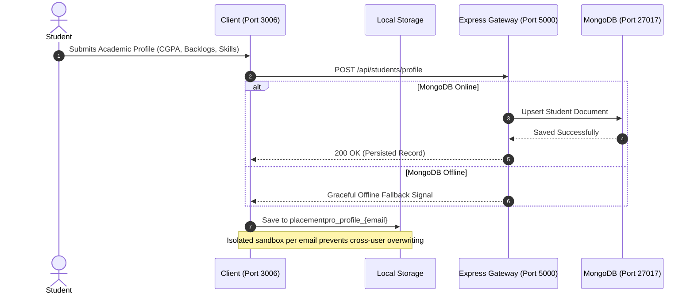
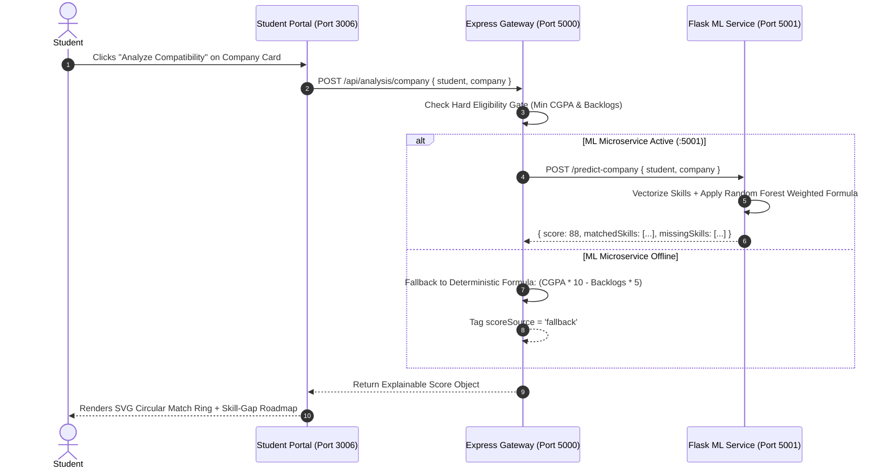
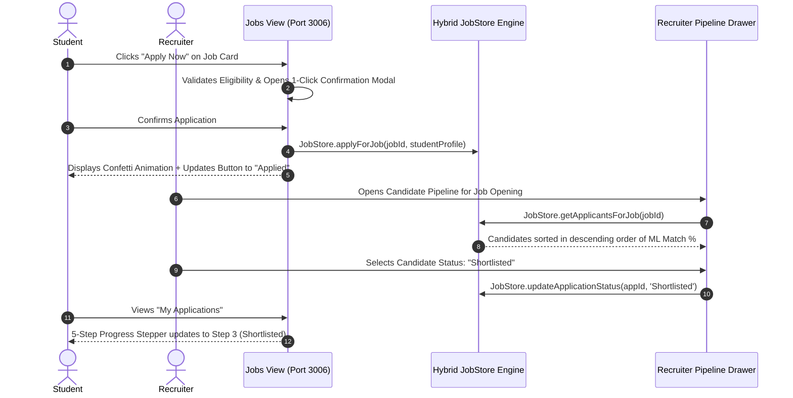

# 🎓 PlacementPro AI — ML-Powered Placement Guidance & Career Acceleration Platform

[](https://nodejs.org/)
[](https://expressjs.com/)
[](https://www.python.org/)
[](https://flask.palletsprojects.com/)
[](https://scikit-learn.org/)
[](https://www.mongodb.com/)
[](https://developer.mozilla.org/en-US/docs/Web/JavaScript)
[](LICENSE)

> **PlacementPro AI** is an enterprise-grade, microservices-driven placement preparation, company eligibility prediction, campus hiring job portal, and live AI resume engineering suite built for engineering students, Training & Placement (T&P) cells, and campus recruiters.

---

## 📌 Table of Contents
1. [Overview & Key Problem Solved](#-overview--key-problem-solved)
2. [Overall Project Blueprint & Design Philosophy](#-overall-project-blueprint--design-philosophy)
3. [Core Feature Modules](#-core-feature-modules)
4. [System Architecture](#-system-architecture)
5. [Detailed File Catalog & System Component Guide](#-detailed-file-catalog--system-component-guide)
   - [Backend Microservice Tier (`Backend/`)](#1-backend-api-gateway-tier-backend)
   - [Machine Learning Microservice Tier (`ML/`)](#2-machine-learning-data-science-tier-ml)
   - [Frontend Client Tier (`Frontend/`)](#3-frontend-client-tier-frontend)
   - [Documentation & Preparation Suite (`Documentation/` & `Interview_Prep_Docs/`)](#4-documentation--interview-preparation-suite)
   - [Developer Portfolio & DSA Sandbox](#5-developer-portfolio--dsa-sandbox)
   - [Root Orchestration & Startup Scripts](#6-root-orchestration--automation-scripts)
6. [End-to-End Data & Execution Flow](#-end-to-end-data--execution-flow)
7. [Services & Port Mapping](#-services--port-mapping)
8. [Machine Learning Engine & Scoring Mathematics](#-machine-learning-engine--scoring-mathematics)
9. [Zero-Crash Resilient Hybrid Architecture](#-zero-crash-resilient-hybrid-architecture)
10. [Repository Directory Structure](#-repository-directory-structure)
11. [Getting Started & Installation Guide](#-getting-started--installation-guide)
12. [API Reference](#-api-reference)
13. [Documentation Suite](#-documentation-suite)
14. [Author & Acknowledgments](#-author--acknowledgments)

---

## 💡 Overview & Key Problem Solved

Traditional campus recruitment suffers from multiple pain points:
* **Academic Guesswork**: Students apply blindly to companies without knowing whether their CGPA, active backlogs, or skill profiles meet real-world corporate cutoffs.
* **Fragmented Management**: Placement cells manage hiring drives through disjointed Google Forms, spreadsheets, and unverified student resumes.
* **Skill-Gap Blindspots**: Students lack visibility into *exactly which skills* are missing to qualify for top-tier roles (Full Stack, Backend, Data Science, DevOps).
* **Weak & Suboptimal Resumes**: Resumes often use passive language, lack quantified metrics, and fail Applicant Tracking Systems (ATS) keyword parsers.

### The Solution: PlacementPro AI
PlacementPro AI delivers an automated, explainable, and production-ready recruitment ecosystem:
1. **Dynamic ML Role & Company Suitability Predictions**: Sub-millisecond compatibility scoring with transparent factor weighting.
2. **Actionable Skill-Gap Diagnostics**: Prioritized learning roadmaps (High / Medium / Low priority) tailored to corporate hiring standards.
3. **Enterprise Campus Job Portal**: Complete hiring workflow with SVG match rings, 1-click application verification with celebratory confetti, and a recruiter pipeline drawer.
4. **Split-Screen Live AI Resume Studio**: Real-time physical A4 resume canvas with 1-click FAANG/MNC upgrading, STAR-method bullet rewriters, and circular ATS score analyzers.
5. **Zero-Crash Hybrid Resilience**: Operates seamlessly whether MongoDB and Python services are online or offline, using email-isolated client-side storage.

---

## 🏛️ Overall Project Blueprint & Design Philosophy

PlacementPro AI is engineered with four foundational principles:

```
┌────────────────────────────────────────────────────────────────────────────────────────┐
│                                PLACEMENTPRO AI BLUEPRINT                               │
├─────────────────────┬───────────────────────┬─────────────────────┬────────────────────┤
│   MICROSERVICES     │    EXPLAINABLE AI     │  RESILIENT HYBRID   │   CLAYMORPHIC UI   │
│     DECOUPLING      │    TRANSPARENCY       │     RELIABILITY     │     AESTHETICS     │
│                     │                       │                     │                    │
│ Independent Node.js │ No black-box scores.  │ Zero "Failed to     │ Modern claymorphic │
│ Gateway (5000),     │ Every score exposes   │ Fetch" errors. Auto │ elevation tokens,  │
│ Python ML API (5001)│ matched skills, gaps, │ falls back between  │ micro-animations,  │
│ & Client (3006).    │ and formula weights.  │ MongoDB & storage.  │ & live SVG meters. │
└─────────────────────┴───────────────────────┴─────────────────────┴────────────────────┘
```

1. **Decoupled Microservice Architecture**: The client UI, Node.js API Gateway, and Python Scikit-Learn data science services run independently on dedicated ports. If one service is restarting, the others maintain functionality.
2. **Explainable AI (XAI)**: Predictions are accompanied by granular breakdowns—matched skills, missing skills, backlog penalties, and source indicators (`ml` vs `fallback`).
3. **Zero-Crash Resilience Policy**: In viva exams or production demos, database network interruptions can occur. PlacementPro AI features automatic silent failover to per-user `localStorage` sandboxes with pre-seeded enterprise corporate data.
4. **Instant Visual Feedback**: State modifications—such as 1-click AI resume upgrades or recruiter candidate shortlisting—update the DOM in real-time with smooth CSS micro-interactions and status badges.

---

## 🚀 Core Feature Modules

### 1. 🤖 ML Career Role & Company Compatibility Predictor
* Evaluates 15+ student vectors: **CGPA, Active Backlogs, Graduation Batch, Degree/Branch, DSA Competency**, and **Technical Skill Tokens**.
* Predicts compatibility across major profiles: **Full Stack Developer, Backend Developer, Frontend Developer, Data Analyst, ML Engineer, and DevOps Engineer**.
* Implements a **Hard Eligibility Gate**: If a candidate violates minimum CGPA or maximum backlog constraints, the score is capped at 58% with explicit eligibility violation flags.

### 2. 🗺️ Actionable Skill-Gap Diagnostics
* Computes mathematical set intersections ($S_{\text{student}} \cap S_{\text{required}}$) against canonical tech stacks.
* Segregates missing competencies into actionable roadmap tiers:
  * 🔴 **High Priority**: Core languages and foundational frameworks required for role clearance.
  * 🟡 **Medium Priority**: Production-ready tools, cloud, and database proficiencies.
  * 🟢 **Low Priority**: Good-to-have auxiliary technologies.

### 3. 💼 Enterprise Job Portal & Application Tracking Suite
* **Interactive Job Explorer (`student/jobs.html`)**: Dynamic smart cards with mathematical SVG circular ML match rings, live countdown urgency badges, and eligibility tags.
* **1-Click Apply Flow**: Modal previewing student academic snapshot with celebratory canvas confetti upon submission.
* **Visual Progress Stepper (`student/applications.html`)**: Interactive 5-step status tracking (`Applied` ➔ `Under Review` ➔ `Shortlisted` ➔ `Selected` ➔ `Rejected`).
* **Recruiter Pipeline Drawer (`admin/jobs.html`)**: Real-time slide-over drawer automatically sorting applicants by their **ML Match %**, allowing 1-click candidate stage transitions.

### 4. 📄 Split-Screen Live AI Resume Studio (`student/resume.html`)
* **38% Left AI Control Panel & 62% Right Live A4 Canvas**: Real-time visual synchronization on a physical A4 desk sheet without page reloading.
* **🚀 1-Click MNC / FAANG Upgrade**: Rewrites basic student summaries and converts casual bullet points into quantified **STAR-method** engineering impacts.
* **⚡ AI Action Verb Booster**: Automatically detects and replaces weak verbs (`made`, `built`, `worked on`) with executive phrasing (`architected`, `engineered`, `spearheaded`).
* **Circular Live ATS Score**: Dynamic SVG ring showing real-time keyword coverage, matched tokens, and missing target terms.
* **Recruiter-Approved Visual Themes**: One-click switching between **FAANG Modern**, **Executive Corporate**, and **Academic Minimalist** styles, with print-ready PDF export.

---

## 🏛️ System Architecture

```
                                    ┌─────────────────────────────────────────────────────────────┐
                                    │                     CLIENT TIER (PORT 3006)                 │
                                    │  HTML5 + CSS3 (Claymorphic) + Bootstrap 5 + Vanilla ES6+ JS │
                                    └──────────────┬──────────────────────────────┬───────────────┘
                                                   │                              │
                            Local Sync Layer       │ HTTP / REST                  │ Direct Browser
                        (JobStore / ProfileStore)  │ CORS Requests                │ Fallback Mode
                                                   ▼                              ▼
                                    ┌──────────────────────────────┐       ┌──────────────────────┐
                                    │    APPLICATION GATEWAY       │       │ ISOLATED LOCALSTORE  │
                                    │      (NODE.JS / EXPRESS)     │       │ placementpro_profile_│
                                    │           PORT 5000          │◄─────►│ placementpro_jobs_   │
                                    └──────────────┬───────────────┘       │ placementpro_apps_   │
                                                   │                       └──────────────────────┘
                         Internal Microservice     │ Mongoose ODM
                         Forwarding (Axios)        │ Connection
                                                   ▼
                    ┌──────────────────────────────┐    ┌──────────────────────────────┐
                    │    DATA SCIENCE TIER         │    │       PERSISTENCE LAYER      │
                    │   (PYTHON 3 / FLASK)         │    │           (MONGODB)          │
                    │        PORT 5001             │    │           PORT 27017         │
                    │  Scikit-Learn Random Forest  │    │ Collections: students, jobs, │
                    │  Feature Matrix Calculators  │    │ applications, companies      │
                    └──────────────────────────────┘    └──────────────────────────────┘
```

---

## 📂 Detailed File Catalog & System Component Guide

This section provides an exhaustive guide to the repository files, their roles, responsibilities, and how they interface across tiers.

```
📁 PROJECT ROOT
│
├── 📁 Backend/                   # Node.js & Express API Gateway Tier
│   ├── 📁 config/                # Database connections and pre-seeding scripts
│   ├── 📁 controllers/           # HTTP Request handlers & business logic
│   ├── 📁 middleware/            # Security, auth, and validation middleware
│   ├── 📁 models/                # Mongoose Object Data Modeling schemas
│   ├── 📁 routes/                # Express API REST route definitions
│   ├── 📁 services/              # Cross-service connectors and scoring logic
│   ├── app.js                    # Express application configuration & CORS
│   ├── package.json              # Backend dependencies & scripts
│   └── server.js                 # Backend bootstrap and entry point
│
├── 📁 ML/                        # Python Data Science & ML Microservice Tier
│   ├── 📁 api/                   # Flask REST microservice endpoints
│   ├── 📁 dataset/               # Synthetic training dataset & features
│   ├── 📁 models/                # Serialized machine learning models (.pkl)
│   ├── 📁 training/              # Model training and evaluation pipelines
│   └── requirements.txt          # Python dependency manifest
│
├── 📁 Frontend/                  # Client Presentation Tier (Claymorphic UI)
│   ├── 📁 admin/                 # Recruiter & Admin management views
│   ├── 📁 css/                   # Design system tokens and styling
│   ├── 📁 js/                    # Client state stores, API bridges, utilities
│   ├── 📁 student/               # Student portal views
│   ├── index.html                # Platform public landing page
│   ├── login.html                # Multi-user authentication portal
│   └── register.html             # Student onboarding & profile setup
│
├── 📁 Documentation/             # Comprehensive 7-part architecture guides
├── 📁 Interview_Prep_Docs/       # Technical viva & project defense documentation
├── 📁 DSA/                       # Data structures & algorithm implementations
├── package.json                  # Root orchestration & multi-tier runner
├── start-servers.bat             # 1-Click launcher script for Windows
├── start-servers.sh              # 1-Click launcher script for Linux/macOS
└── index.html                    # Developer portfolio (Roni Maity)
```

---

### 1. Backend API Gateway Tier (`Backend/`)

The Backend tier acts as the central API orchestrator, data validator, and bridge between the client and the Python ML service.

| File Path | Component | Detailed Role & Functionality |
| :--- | :--- | :--- |
| [`Backend/server.js`](file:///Backend/server.js) | Server Bootstrap | Initializes the Node.js HTTP server on Port `5000`. Connects to MongoDB via Mongoose, attaches uncaught exception and unhandled rejection handlers, and logs operational startup state. |
| [`Backend/app.js`](file:///Backend/app.js) | Express App Config | Configures Express middleware, JSON body parsing, CORS allowlist (`http://127.0.0.1:3006`, `http://localhost:3006`, `null` for `file://`), mounts API routes, defines `/api/health`, and provides global error handling. |
| [`Backend/config/db.js`](file:///Backend/config/db.js) | Database Connection | Connects to MongoDB (`mongodb://localhost:27017/placement-system`) with timeout configs and graceful fallback logging if the local MongoDB daemon is not running. |
| [`Backend/config/seedJobs.js`](file:///Backend/config/seedJobs.js) | Enterprise Job Seeder | Pre-populates the database with 6 tier-1 enterprise campus recruitment postings: TCS Digital, Infosys Power Programmer, Zoho MTS, Flipkart SDE-1, Amazon SDE Intern, and Cognizant GenC Next. |
| [`Backend/config/seedCompanies.js`](file:///Backend/config/seedCompanies.js) | Company Data Seeder | Ingests corporate recruitment profiles, minimum CGPA thresholds, allowable backlog limits, eligible engineering branches, and expected skill tags. |
| [`Backend/controllers/jobController.js`](file:///Backend/controllers/jobController.js) | Job Management Controller | Implements CRUD operations for campus jobs. Computes eligibility filters, handles job activation toggling, and queries the applicant pipeline for recruiters. |
| [`Backend/controllers/applicationController.js`](file:///Backend/controllers/applicationController.js) | Application Controller | Manages job applications. Prevents duplicate submissions, retrieves candidate applications by student email, and handles recruiter status transitions (`Applied`, `Shortlisted`, `Selected`, etc.). |
| [`Backend/controllers/analysisController.js`](file:///Backend/controllers/analysisController.js) | Compatibility Controller | Routes suitability requests to the Python ML microservice via Axios. If the ML tier is unreachable, it seamlessly invokes a deterministic academic formula (`CGPA * 10 - Backlogs * 5`) so the client never crashes. |
| [`Backend/controllers/companyController.js`](file:///Backend/controllers/companyController.js) | Company Controller | Provides company catalog listings, criteria retrieval, and company profile updates. |
| [`Backend/controllers/studentController.js`](file:///Backend/controllers/studentController.js) | Student Controller | Handles student registration, profile updates, academic parameter ingestion, and skill inventory saves. |
| [`Backend/models/Student.js`](file:///Backend/models/Student.js) | Student Schema | Mongoose schema defining student profile fields: personal info, academic details (CGPA, backlogs, branch, graduation year), skills array, projects, certifications, and experience. |
| [`Backend/models/Job.js`](file:///Backend/models/Job.js) | Job Schema | Mongoose schema defining corporate postings: title, company, description, eligibility criteria (min CGPA, max backlogs, branches), CTC/stipend, work mode, and deadline. |
| [`Backend/models/JobApplication.js`](file:///Backend/models/JobApplication.js) | Application Schema | Schema linking a Student and Job. Stores application stage status, candidate academic snapshot, and submission timestamps. |
| [`Backend/models/Company.js`](file:///Backend/models/Company.js) | Company Schema | Mongoose schema defining corporate benchmarks, package bands, criteria, and canonical required skill tags. |
| [`Backend/services/eligibilityService.js`](file:///Backend/services/eligibilityService.js) | Hard Eligibility Gate | Evaluates deterministic criteria: verifies if student CGPA $\ge$ minimum requirement, backlogs $\le$ allowable threshold, and student branch matches eligible branches. |
| [`Backend/services/skillGapService.js`](file:///Backend/services/skillGapService.js) | Skill Gap Engine | Computes skill intersection matrices, categorizes missing technologies into priority tiers, and generates explainable score objects. |
| [`Backend/routes/`](file:///Backend/routes/) | Express Routes | Contains `studentRoute.js`, `jobRoute.js`, `applicationRoute.js`, `companyRoute.js`, and `analysisRoute.js`, wiring endpoints to controllers. |

---

### 2. Machine Learning / Data Science Tier (`ML/`)

The ML tier runs on Port `5001` as an independent Python microservice dedicated to statistical evaluation, role classification, and skill-gap diagnostics.

| File Path | Component | Detailed Role & Functionality |
| :--- | :--- | :--- |
| [`ML/api/ml_api.py`](file:///ML/api/ml_api.py) | Flask ML Microservice | WSGI Flask application. Contains the canonical `ROLE_PROFILES` database. Exposes REST endpoints: `/predict-role`, `/predict-company`, `/skill-gap`, and `/health`. Implements weighted scoring and backlog penalty logic. |
| [`ML/training/train_models.py`](file:///ML/training/train_models.py) | Model Training Pipeline | Ingests student feature data, builds vectorizers for skill tokens, trains the `RandomForestClassifier` ensemble, evaluates cross-validation accuracy, and serializes estimators. |
| [`ML/models/role_model.pkl`](file:///ML/models/role_model.pkl) | Serialized Model Artifact | Joblib/pickle serialized binary containing the pre-trained Random Forest decision tree estimators for sub-millisecond inference. |
| [`ML/dataset/synthetic_students.json`](file:///ML/dataset/synthetic_students.json) | Training Dataset | Synthesized dataset of diverse student profiles containing academic metrics, skill sets, project depths, and career placement outcomes. |
| [`ML/requirements.txt`](file:///ML/requirements.txt) | Dependencies Manifest | Specifies version-locked Python libraries: `flask==3.0.0`, `pandas==2.1.0`, `scikit-learn==1.3.0`, and `numpy==1.25.2`. |

---

### 3. Frontend Client Tier (`Frontend/`)

The presentation tier runs on Port `3006`, built with semantic HTML5, claymorphic CSS tokens (`--pp-clay`, `--pp-surface`), Bootstrap 5 grid utilities, and native ES6+ JavaScript.

#### Student Portal Views (`Frontend/student/`)
| File Path | View Name | Detailed Functionality |
| :--- | :--- | :--- |
| [`Frontend/student/dashboard.html`](file:///Frontend/student/dashboard.html) | Student Dashboard | Central hub for logged-in students. Displays overall profile completion meter, top predicted career role, quick links to job explorer, and recent application status. |
| [`Frontend/student/profile.html`](file:///Frontend/student/profile.html) | Profile Builder | Multi-section academic and technical profile management. Inputs for Class 10/12 %, B.Tech CGPA, active backlogs, engineering branch, interactive skill tags, projects, and certifications. |
| [`Frontend/student/jobs.html`](file:///Frontend/student/jobs.html) | Explore Campus Jobs | Displays smart cards for corporate openings. Includes SVG circular ML match rings, eligibility status pills, urgency countdown badges, search/filter toolbar, and 1-click apply modal with celebratory confetti. |
| [`Frontend/student/applications.html`](file:///Frontend/student/applications.html) | My Applications | Real-time tracker for submitted job applications. Features an interactive 5-step visual stepper (`Applied` ➔ `Under Review` ➔ `Shortlisted` ➔ `Selected` ➔ `Rejected`) with timestamped audit logs. |
| [`Frontend/student/resume.html`](file:///Frontend/student/resume.html) | Live AI Resume Studio | Split-screen workspace (38% left AI control panel, 62% right sticky A4 physical canvas). Features 1-click MNC/FAANG rewriter, AI action verb booster, circular live ATS score, zoom controls, and print-ready PDF export. |
| [`Frontend/student/roles.html`](file:///Frontend/student/roles.html) | Career Role Predictions | Renders predicted software engineering profiles (Full Stack, Backend, Frontend, Data Analyst, ML, DevOps) with ranked compatibility match percentages and skill tags. |
| [`Frontend/student/companies.html`](file:///Frontend/student/companies.html) | Company Compatibility | Analyzes student compatibility against top corporate recruiters (TCS, Infosys, Zoho, etc.) with explicit hard eligibility gate notifications. |
| [`Frontend/student/skill-gap.html`](file:///Frontend/student/skill-gap.html) | Skill-Gap Diagnostic | Visual breakdown of required versus missing competencies for target roles, categorized into High, Medium, and Low priority roadmaps. |
| [`Frontend/student/analysis.html`](file:///Frontend/student/analysis.html) | Comprehensive Analysis | Aggregated analytical dashboard displaying radar and bar charts for academic strength, technical competency, and placement readiness. |

#### Recruiter & Admin Portal (`Frontend/admin/`)
| File Path | View Name | Detailed Functionality |
| :--- | :--- | :--- |
| [`Frontend/admin/jobs.html`](file:///Frontend/admin/jobs.html) | Recruiter Job Management | Job listing data table with live search and status toggles. Multi-section modal for creating corporate openings. Includes the `#applicantDrawer` slide-over pipeline automatically ranking candidates by **ML Match %**. |
| [`Frontend/admin/dashboard.html`](file:///Frontend/admin/dashboard.html) | Recruiter Dashboard | Campus recruitment overview displaying total openings, applicant volumes, shortlisted tallies, and branch distribution stats. |

#### Client-Side Logic & State Engines (`Frontend/js/`)
| File Path | Module | Detailed Role & Functionality |
| :--- | :--- | :--- |
| [`Frontend/js/job-store.js`](file:///Frontend/js/job-store.js) | Hybrid Job & App Store | Unified data layer managing jobs and applications. Attempts backend API sync; falls back seamlessly to per-user `localStorage` keys (`placementpro_jobs_<email>`, `placementpro_applications_<email>`). Contains 6 pre-seeded corporate openings. |
| [`Frontend/js/student-profile.js`](file:///Frontend/js/student-profile.js) | Student Profile Store | Manages candidate profile state with email-isolated sandboxing (`placementpro_profile_<email>`). Ensures multiple students using the same browser never overwrite data. |
| [`Frontend/js/companies-data.js`](file:///Frontend/js/companies-data.js) | Corporate Data Catalog | Client-side database of company recruitment criteria, hiring benchmarks, logo assets, and required tech stacks. |
| [`Frontend/js/company.js`](file:///Frontend/js/company.js) | Company UI Logic | Handles client-side company rendering, search filtering, and compatibility score card generation. |
| [`Frontend/js/api.js`](file:///Frontend/js/api.js) | Central API Client | Standardized `fetch` wrapper with base URL resolution, timeout controls, and unified JSON parsing. |
| [`Frontend/js/auth-guard.js`](file:///Frontend/js/auth-guard.js) | Route Authentication Guard | Inspects session state before page rendering. Redirects unauthenticated users to `login.html` and prevents students from accessing admin routes. |
| [`Frontend/js/layout.js`](file:///Frontend/js/layout.js) | Navigation & Layout Helper | Injects sticky navigation bars, user profile badges, logout buttons, and active link states across portal views. |

#### Design System & Base Pages
| File Path | Module | Detailed Role & Functionality |
| :--- | :--- | :--- |
| [`Frontend/css/style.css`](file:///Frontend/css/style.css) | Core Design System | Custom CSS stylesheet defining claymorphic elevation variables (`--pp-clay`, `--pp-surface`), HSL color palettes, card hover micro-animations, and responsive media queries. |
| [`Frontend/index.html`](file:///Frontend/index.html) | Landing Page | Public-facing landing page showcasing system capabilities, hero animations, feature highlights, and entry points for students and administrators. |
| [`Frontend/login.html`](file:///Frontend/login.html) | Login Portal | Authentication view supporting student and recruiter login with automatic redirection to role-specific dashboards. |
| [`Frontend/register.html`](file:///Frontend/register.html) | Registration Portal | Student registration view initializing sandboxed local storage profile entries upon account creation. |

---

### 4. Documentation & Interview Preparation Suite

The repository contains an exhaustive 7-volume documentation library alongside interview and viva defense preparation materials.

| File Path | Volume / Topic | Detailed Contents |
| :--- | :--- | :--- |
| [`Documentation/01_Project_Overview.md`](file:///Documentation/01_Project_Overview.md) | System Overview | Executive summary, 3-tier architecture diagrams, end-to-end sequence flows, and architectural innovations. |
| [`Documentation/02_Backend_Explained.md`](file:///Documentation/02_Backend_Explained.md) | Backend Architecture | Deep dive into Express controllers, Mongoose schemas, CORS security, error handling, and cross-tier Axios forwarding. |
| [`Documentation/03_Machine_Learning_Explained.md`](file:///Documentation/03_Machine_Learning_Explained.md) | ML Engine & Math | Mathematical formulation of Random Forest classification, Gini impurity, feature vectors, and scoring equations. |
| [`Documentation/04_Frontend_Explained.md`](file:///Documentation/04_Frontend_Explained.md) | Frontend & Design | Claymorphic design tokens, layout hierarchy, mobile responsiveness, DOM manipulation, and performance optimization. |
| [`Documentation/05_How_To_Run_Project.md`](file:///Documentation/05_How_To_Run_Project.md) | Execution Guide | Comprehensive deployment guide covering prerequisites, one-click scripts, manual multi-terminal commands, and troubleshooting. |
| [`Documentation/06_Job_Portal_And_Application_System.md`](file:///Documentation/06_Job_Portal_And_Application_System.md) | Job Portal & Pipeline | Recruiter job creator, slide-over candidate drawer with ML match sorting, and student 5-step application stepper. |
| [`Documentation/07_Live_AI_Resume_Studio.md`](file:///Documentation/07_Live_AI_Resume_Studio.md) | AI Resume Studio | Split-screen architecture, STAR-method bullet point transformation, dictionary-based action verb replacement, and live ATS scoring. |
| [`Interview_Prep_Docs/Viva_And_Interview_Bible.md`](file:///Interview_Prep_Docs/Viva_And_Interview_Bible.md) | Viva & Interview Bible | 39KB+ encyclopedia of technical questions, edge cases, examiner defense points, and software engineering explanations. |
| [`Interview_Prep_Docs/Project_Mastery_Guide.md`](file:///Interview_Prep_Docs/Project_Mastery_Guide.md) | Project Mastery Guide | Summary cheat sheets and quick reference points for project presentations and faculty reviews. |

---

### 5. Developer Portfolio & DSA Sandbox

| File Path | Component | Detailed Role & Functionality |
| :--- | :--- | :--- |
| [`index.html`](file:///index.html) | Developer Portfolio | Personal portfolio website of developer **Roni Maity** (B.Tech Information Technology). Features education credentials, technical skill groups, certifications, and project spotlights. |
| [`script.js`](file:///script.js) | Portfolio Logic | Handles smooth scrolling, theme interactions, and dynamic element rendering for the portfolio page. |
| [`style.css`](file:///style.css) | Portfolio Styling | Clean glassmorphic and coastal aesthetic stylesheets custom-tailored for the developer portfolio. |
| [`profile.jpeg`](file:///profile.jpeg) | Developer Photo | High-resolution professional profile photo featured on the portfolio landing view. |
| [`DSA/practices.py`](file:///DSA/practices.py) | DSA Practice Suite | Python implementations of foundational data structures, algorithmic problem solving, array operations, and traversal patterns. |

---

### 6. Root Orchestration & Automation Scripts

| File Path | Component | Detailed Role & Functionality |
| :--- | :--- | :--- |
| [`package.json`](file:///package.json) | Root Orchestrator | Uses `concurrently` to run the Backend Gateway (`port 5000`), Python ML Microservice (`port 5001`), and Frontend (`port 3006`) concurrently via `npm run dev`. |
| [`start-servers.bat`](file:///start-servers.bat) | Windows 1-Click Launcher | Automatically kills any stale processes on ports 5000 and 5001, verifies Python dependencies, and launches all three tiers in a unified terminal window. |
| [`start-servers.sh`](file:///start-servers.sh) | Linux/macOS Launcher | Shell script equivalent of the launcher for Unix environments, verifying dependencies and starting the dev server. |
| [`test_endpoints.js`](file:///test_endpoints.js) | API Health Probe | Node.js verification script that tests gateway and ML endpoints to ensure proper network connectivity. |

---

## 🔄 End-to-End Data & Execution Flow

To understand how the entire system functions as a cohesive unit, here are the primary data flows:

### Flow 1: Student Profile Creation & Isolated Sandboxing


### Flow 2: Machine Learning Role & Company Compatibility Calculation


### Flow 3: Job Application & Recruiter Candidate Management Pipeline


---

## 🌐 Services & Port Mapping

| Service | Port | Base URL | Technology Stack | Purpose |
| :--- | :---: | :--- | :--- | :--- |
| **Frontend Client** | `3006` | `http://127.0.0.1:3006` | HTML5, CSS3 Claymorphic, ES6+ | Student & Admin Web Portals |
| **Backend Gateway** | `5000` | `http://127.0.0.1:5000` | Node.js, Express.js, Mongoose | API Gateway, Business Logic, DB Orchestration |
| **ML Microservice** | `5001` | `http://127.0.0.1:5001` | Python 3, Flask, Scikit-Learn | Role Prediction, Company Suitability, Skill Gap |
| **Database** | `27017` | `mongodb://localhost:27017` | MongoDB (Mongoose ODM) | Persistent storage for users, jobs, applications |

---

## 🧠 Machine Learning Engine & Scoring Mathematics

### Model: Random Forest Ensemble (`RandomForestClassifier`)
* **Why Random Forest?**: Student skill compatibility is inherently non-linear (e.g., Python + Pandas signifies Data Science; Python + Django signifies Backend). Random Forest resists overfitting through bootstrap aggregation (bagging), handles categorical and numerical vectors seamlessly, and operates with sub-millisecond inference latency without GPU dependencies.

### Mathematical Formulation
1. **Academic Feature Sub-Matrix ($X_{\text{acad}}$)**:
   * $\text{CGPA} \in [0.0, 10.0]$
   * $\text{Backlogs} \in [0, \infty)$
   * $\text{Graduation Year} \in [2024, 2028]$

2. **DSA Competency Weight ($X_{\text{dsa}}$)**:
   $$\text{DSA Weight} = \begin{cases} 0.40 & \text{if Beginner} \\ 0.75 & \text{if Intermediate} \\ 1.00 & \text{if Advanced} \end{cases}$$

3. **Skill Intersection Ratio**:
   $$\text{Skill Ratio} = \frac{|S_{\text{student}} \cap S_{\text{required}}|}{|S_{\text{required}}|}$$

4. **Base Role Compatibility Score**:
   $$\text{Base Score} = \left( \text{Skill Ratio} \times W_{\text{skills}} + \frac{\text{CGPA}}{10} \times W_{\text{cgpa}} + \text{DSA Weight} \times W_{\text{dsa}} \right) \times 100$$

5. **Backlog Penalty & Clamped Role Score**:
   $$\text{Backlog Penalty} = \text{Backlogs} \times 4$$
   $$\text{Final Role Score} = \min\left(99, \max\left(35, \text{round}(\text{Base Score} - \text{Backlog Penalty})\right)\right)$$

*Hard Gate Violation*: If $\text{CGPA} < \text{Req CGPA}$ or $\text{Backlogs} > \text{Max Backlogs}$, the company suitability score is capped at **58%** to indicate that academic prerequisites block registration.

---

## 🛡️ Zero-Crash Resilient Hybrid Architecture

PlacementPro AI incorporates a strict **Zero Failed-to-Fetch Policy**:
* **Silent Failover**: When MongoDB or Express is offline, the client seamlessly routes operations through `localStorage` without presenting errors.
* **Pre-Seeded Corporate Catalog**: Six premier campus opportunities (**TCS Digital, Infosys Power Programmer, Zoho MTS, Flipkart SDE-1, Amazon SDE Intern, Cognizant GenC Next**) are permanently embedded.
* **Multi-User Email Sandboxing**: Storage keys (`placementpro_profile_<email>`, `placementpro_applications_<email>`, `placementpro_resume_ai_state_<email>`) isolate candidate states completely.

---

## ⚡ Getting Started & Installation Guide

### System Prerequisites
* **Node.js**: v18.0.0 or higher ([Download Node.js](https://nodejs.org/))
* **Python**: v3.8 or higher ([Download Python](https://www.python.org/))
* **MongoDB** *(Optional)*: v6.0+ on port 27017 (System operates in fallback mode if offline)
* **Modern Web Browser**: Google Chrome, Microsoft Edge, Mozilla Firefox, Brave

---

### Option A: Windows One-Click Launcher (Recommended)
1. In the root workspace, double-click **`start-servers.bat`**.
2. The batch launcher will automatically:
   * Terminate any lingering processes occupying ports `5000` or `5001`.
   * Check and install missing Python packages (`flask`, `flask-cors`, `joblib`).
   * Launch the Backend, ML service, and Frontend concurrently in a unified terminal.
3. Open your browser and navigate to: **`http://127.0.0.1:3006`**

---

### Option B: Linux / macOS Launcher
```bash
chmod +x start-servers.sh
./start-servers.sh
```
Open your browser at: **`http://127.0.0.1:3006`**

---

### Option C: Universal Terminal Command
From the root workspace:
```bash
npm install
npm run dev
```

---

### Option D: Manual Multi-Terminal Execution

#### Terminal 1: Backend Gateway (Port 5000)
```bash
cd Backend
npm install
npm run dev
```

#### Terminal 2: ML Microservice (Port 5001)
```bash
cd ML
pip install -r requirements.txt
python -u api/ml_api.py
```

#### Terminal 3: Frontend Client (Port 3006)
```bash
npx live-server Frontend --port=3006 --cors
```

---

## 📡 API Reference

### Express API Gateway (`http://127.0.0.1:5000`)
| Method | Endpoint | Description |
| :--- | :--- | :--- |
| `GET` | `/api/health` | Gateway health check probe |
| `POST` | `/api/students/profile` | Create or update student academic profile |
| `GET` | `/api/students/profile/:email` | Retrieve student profile by email |
| `POST` | `/api/analysis/predict-role` | Proxy request to ML service for role prediction |
| `POST` | `/api/analysis/company` | Calculate company suitability and skill gaps |
| `GET` | `/api/jobs` | Retrieve all active campus recruitment postings |
| `POST` | `/api/jobs` | Create a new campus job opening (Admin/Recruiter) |
| `POST` | `/api/applications` | Submit a candidate job application |
| `GET` | `/api/applications/student/:email` | Retrieve all applications for a student |
| `PATCH` | `/api/applications/:id/status` | Update candidate hiring stage (`Shortlisted`, etc.) |

### Python ML Microservice (`http://127.0.0.1:5001`)
| Method | Endpoint | Description |
| :--- | :--- | :--- |
| `GET` | `/health` | Machine learning microservice health probe |
| `POST` | `/predict-role` | Computes multi-class probability scores across roles |
| `POST` | `/predict-company` | Computes 0-100% suitability score for a company |
| `POST` | `/skill-gap` | Evaluates required versus missing technical competencies |

---

## 📚 Documentation Suite

For exhaustive technical guides, explore the dedicated documentation in [`Documentation/`](file:///Documentation):
* [01. System Architecture Overview](file:///Documentation/01_Project_Overview.md) — Architectural patterns, sequence flows, and core design.
* [02. Backend Gateway & Controller Logic](file:///Documentation/02_Backend_Explained.md) — Express middleware, routes, Mongoose schemas, and endpoints.
* [03. Machine Learning Microservice & Math](file:///Documentation/03_Machine_Learning_Explained.md) — Random Forest classifier, feature vectors, and scoring formulas.
* [04. Frontend Claymorphic UI Architecture](file:///Documentation/04_Frontend_Explained.md) — Claymorphic tokens, responsive grids, and micro-interactions.
* [05. Setup, Deployment & Troubleshooting](file:///Documentation/05_How_To_Run_Project.md) — Comprehensive execution, port clearance, and environment guides.
* [06. Job Portal & Application Management](file:///Documentation/06_Job_Portal_And_Application_System.md) — Recruiter job board, ML applicant drawer, and progress tracking.
* [07. Live AI Resume Studio Architecture](file:///Documentation/07_Live_AI_Resume_Studio.md) — Split-screen editor, STAR-method bullet rewriting, and ATS scoring.
* [Viva & Technical Interview Comprehensive Bible](file:///Interview_Prep_Docs/Viva_And_Interview_Bible.md) — Comprehensive Q&A encyclopedia for academic viva defense.
* [Project Mastery Guide](file:///Interview_Prep_Docs/Project_Mastery_Guide.md) — Quick reference review sheet for project presentations.

---

## 👨‍💻 Author & Acknowledgments

* **Developer**: **Roni Maity** ([@maityroni2005-sys](https://github.com/maityroni2005-sys))
* **Degree**: B.Tech in Information Technology
* **Repository**: [maityroni2005-sys/PROJECT](https://github.com/maityroni2005-sys/PROJECT)
* **Institution**: College of Engineering and Management, Kolaghat

---
*⭐ If you find this project valuable for campus placement preparation and student guidance, don't hesitate to star the repository!*
